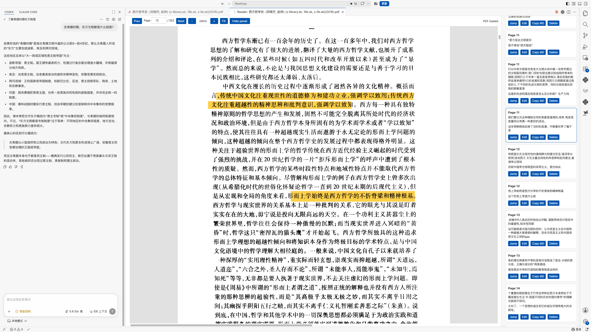

<div align="center">
  
  <h1>Inleaf Reader</h1>
  <p><strong>Your Books. Your AI. Your Flow.</strong></p>
  <p>在 VS Code 里阅读 PDF，用你自己的 AI 随时提问，让思考不断流。</p>
</div>

[English](README.md) | [简体中文](README.zh-CN.md)



## Inleaf Reader 是什么？

Inleaf Reader 把 VS Code 变成阅读论文和书籍的专注空间。批注、翻译、记单词等常用操作就在原文旁边；你也可以搭配自己熟悉的 AI 助手，查询背景、追问问题，而不必反复离开阅读页面。

阅读数据保存在 PDF 旁边的普通文件中，由你自己掌控。它们方便备份、同步，也方便 AI 读取和整理。

### 你可以用它做什么？

- **顺畅阅读：**连续滚动、记录阅读进度、适应页面宽度和触控板缩放。
- **使用自己的 AI：**搭配 Codex、Claude Code 等助手，不绑定阅读器专属的付费 AI 服务。
- **就地批注：**高亮、下划线、笔记和标签，都可以在原文旁编辑。
- **随读随译：**使用内置离线词典、本地 Argos Translate，或自行配置 DeepSeek、LibreTranslate。
- **积累单词：**为每份 PDF 保存英语单词及结构化释义。
- **让数据方便 AI 使用：**批注、单词、导出内容和进度采用可迁移的本地文件格式。
- **减少打扰：**侧边面板默认隐藏，只有主动打开时才出现。

## 整理阅读笔记（试用）

打开批注面板，点击 **整理阅读笔记**。选择当前 PDF 或多个 PDF，分别输入 PDF 页码范围（如 `1-5, 8`，留空代表全部），再选择标签、是否仅包含带评论的高亮，以及忠实摘录、主题整理或分享文章。

确认向导显示的批注数量后选择保存目录，即可得到 `notes.md`、`notes.json` 和 `整理说明.md`。跨页批注完整保留，不截断引用。

把整个整理包交给你自己的 AI，按说明生成预览，再写入你的 Notion。扩展本身不连接或自动上传 Notion；导出包含原文、个人批注和来源标识，不包含本机完整路径。标题、作者和印刷页码未识别时保持未知。

## 适合谁？

- 经常在 VS Code 中工作，同时阅读论文或技术书籍的人。
- 希望批注和阅读进度与 PDF 一起保存的人。
- 希望在阅读窗口旁使用 Codex、Claude Code 等助手的人。
- 偏好离线工具、自主掌控数据，不想被强制要求注册云端账号的人。

## 安装

### 使用 VSIX 安装包

从 [GitHub 最新 Release](https://github.com/WORMMMMMM/inleaf-reader/releases/latest) 下载 VSIX，在 VS Code 命令面板中执行 **Extensions: Install from VSIX...**（扩展：从 VSIX 安装），选择下载的文件。

也可以在终端安装，将文件名替换为你下载的版本：

```bash
code --install-extension inleaf-reader-0.1.4.vsix
```

如果安装后没有立即出现阅读器命令，执行一次 **Developer: Reload Window**（开发人员：重新加载窗口）。

> 从更早的非 Inleaf 版本迁移？VS Code 会把 `ziming.inleaf-reader` 视为另一个扩展。请安装 Inleaf Reader，移除旧扩展，再重新打开各个 PDF。已有本地阅读数据会复制到 `.inleaf-reader/`，不会覆盖当前文件。翻译服务配置和 API 密钥需要重新设置。

### VS Code 扩展市场

公开上架后，可以在扩展市场搜索 **Inleaf Reader** 并点击安装。

## 三步开始阅读

1. 在 VS Code 中打开 PDF，点击编辑器标题栏里的蓝色套叠书本图标；也可以右键 PDF，选择 **Inleaf Reader: Open Paper Reader**。
2. 选中文字，即可高亮、添加下划线、写批注、翻译或保存单词。
3. 继续阅读。批注和页面进度自动保存，不需要额外点击保存按钮。

右侧面板启动时保持隐藏。点击 **Show panel** 浏览批注、单词和翻译结果；点击旁边的 **Settings**，可以启用或隐藏阅读功能、调整面板顺序、配置翻译，无需离开阅读器。

## 我的数据保存在哪里？

对于 `paper.pdf`，扩展会在其旁边的 `.inleaf-reader/` 文件夹中自动维护：

```text
.inleaf-reader/
  paper.pdf.annotations.json   # 高亮、下划线、笔记和标签
  paper.pdf.wordbook.json      # 已保存的单词
  paper.pdf.progress.json      # 上次阅读位置
```

以下文件只在你主动执行对应导出操作时生成：

```text
paper.pdf.annotations.md     # Markdown 批注导出
paper.pdf.annotated.pdf      # 带可见标记和评论的 PDF
```

这些都是普通本地文件，可以通过 Git、iCloud Drive、Dropbox、Syncthing 等工具复制或同步。JSON 使用原子写入，读取时进行校验，并通过 `schemaVersion` 标记格式版本。上一个有效版本保留为 `.bak`；如果当前文件损坏，扩展会恢复备份，并将损坏文件保留为 `.corrupt-<timestamp>`。旧的数组格式会自动迁移。

拥有工作区访问权限的 AI 可以直接使用这些结构化批注和单词数据，不依赖专有云端数据库。JSON 顶层结构如下：

```json
{ "schemaVersion": 1, "annotations": [] }
{ "schemaVersion": 1, "words": [] }
{ "schemaVersion": 1, "progress": { "page": 12, "updatedAt": "..." } }
```

PDF 移动或改名后，扩展会借助内容指纹查找并复制缺失的阅读数据，不覆盖新位置已有的文件。

## 翻译方式

| 方式 | 适用场景 | 网络与配置 |
| --- | --- | --- |
| 内置 ECDICT | 查询单个英语单词 | 离线，无需配置 |
| Argos Translate | 本地翻译句子和段落 | 安装 Python 和语言模型后可离线使用 |
| DeepSeek | 较高质量的学术翻译 | 使用你自己的 API 密钥，将选中文本发送给 DeepSeek |
| LibreTranslate | 自托管或兼容的翻译服务 | 将选中文本发送到你配置的服务地址 |

单个英语单词优先查询内置 ECDICT 词典。词典约有 77 万个词条，可显示音标、中文释义、英文解释、词性和词形。词典按压缩分片存储，后台进程只加载当前查询所需的分片，不会在打开 PDF 或普通查词时把整部词典载入内存。

### DeepSeek

执行 **Inleaf Reader: Set DeepSeek API Key**，或在阅读器 **Settings** 中选择 DeepSeek。密钥只保存在 VS Code SecretStorage，不会写入网页界面、设置文件、阅读数据或日志。

执行 **Inleaf Reader: Clear DeepSeek API Key** 可移除密钥。

### LibreTranslate

在阅读器 **Settings** 中选择 LibreTranslate，填写兼容的服务地址。高级用户也可以直接设置 `inleafReader.translationProvider` 和 `inleafReader.libreTranslateEndpoint`。

<details>
<summary><strong>可选：配置本地 Argos Translate</strong></summary>

由于 Python 和 Argos 神经网络模型依赖具体操作系统，VSIX 不包含它们，需要单独安装。

macOS 或 Linux：

```bash
python3 -m venv ~/.inleaf-reader-argos
source ~/.inleaf-reader-argos/bin/activate
python -m pip install --upgrade pip argostranslate
```

Windows PowerShell：

```powershell
py -m venv $HOME\.inleaf-reader-argos
& $HOME\.inleaf-reader-argos\Scripts\Activate.ps1
python -m pip install --upgrade pip argostranslate
```

使用 [Argos 官方包接口](https://github.com/argosopentech/argos-translate) 安装英译中模型：

```python
import argostranslate.package

argostranslate.package.update_package_index()
packages = argostranslate.package.get_available_packages()
package = next(
    item for item in packages
    if item.from_code == "en" and item.to_code == "zh"
)
argostranslate.package.install_from_path(package.download())
```

随后在阅读器 **Settings** 中设置 Argos Python 路径。高级用户可以直接配置 `inleafReader.argosPythonPath`，例如：

```json
{
  "inleafReader.translationProvider": "argos",
  "inleafReader.argosPythonPath": "/Users/you/.inleaf-reader-argos/bin/python"
}
```

首次翻译句子时会启动本地常驻进程并加载模型，后续请求复用该进程。

</details>

如果翻译不可用，执行 **Inleaf Reader: Diagnose Translation Setup** 检查环境。

## 隐私

- 当前不收集遥测或使用分析数据。
- PDF 和阅读数据保存在你选择的本地路径。
- ECDICT 离线查词和 Argos 本地翻译均在本机完成。
- 只有选择 DeepSeek 或 LibreTranslate 时，选中文本才会发送给对应服务。
- VS Code 全局状态中只保存用于移动、改名恢复的轻量路径索引，不保存批注或单词内容。

向外部翻译服务发送敏感文本前，请了解该服务的隐私条款。

## 当前限制

- 没有文本层的扫描版 PDF 无法选中文字，需要先自行 OCR。
- 页眉、页脚、页码和插图排除采用启发式规则，不能保证对所有 PDF 都准确。
- Argos Translate 需要单独安装 Python 和语言模型。
- 当前词典和本地翻译流程主要面向英语到中文的阅读场景。
- 项目仍处于预览阶段，请备份重要 PDF 和阅读数据。

## 命令

| 命令 | 用途 |
| --- | --- |
| `Inleaf Reader: Open Paper Reader` | 打开当前 PDF，或选择一个 PDF |
| `Inleaf Reader: Set DeepSeek API Key` | 安全保存或替换 DeepSeek 密钥 |
| `Inleaf Reader: Clear DeepSeek API Key` | 删除已保存的 DeepSeek 密钥 |
| `Inleaf Reader: Diagnose Translation Setup` | 检查词典和翻译环境是否就绪 |

## 参与开发

本地开发、测试和手动检查步骤见 [CONTRIBUTING.md](CONTRIBUTING.md)。欢迎在 [GitHub](https://github.com/WORMMMMMM/inleaf-reader) 提交 Issue 和 Pull Request。

## 使用的开源项目

- [PDF.js](https://mozilla.github.io/pdf.js/)
- [react-pdf-highlighter-plus](https://github.com/QuocVietHa08/react-pdf-highlighter-plus)
- [pdf-lib](https://pdf-lib.js.org/)
- [Argos Translate](https://www.argosopentech.com/)
- [ECDICT](https://github.com/skywind3000/ECDICT)

第三方组件和内置资源分别遵循各自的许可协议，详见 [THIRD_PARTY_NOTICES.md](THIRD_PARTY_NOTICES.md)。

## 许可证

Inleaf Reader 使用 [Apache License 2.0](LICENSE) 开源。你可以按照协议使用、修改、分发和商用本软件。协议同时提供明确的专利授权，并要求保留适用的版权和署名声明。
